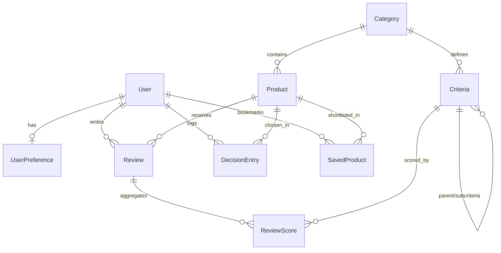

# Decision Intelligence Platform

A Multi-Criteria Decision Analysis (MCDA) web application built with **Django** and **PostgreSQL**. Users assign priority weights (0..10) or choose persona presets to rank products, inspect RTINGS-style consensus summaries, compare models side-by-side (Apple/Baymard style), and track pre-purchase expectations against post-purchase reality in a personal Decision Journal.

---

## 1. Quick Start & Installation (uv + PostgreSQL)

```bash
cp .env.example .env
uv sync
uv run python manage.py migrate
uv run python manage.py seed_data
uv run python manage.py test
uv run python manage.py runserver
```

Demo Credentials: admin@example.com / admin1234

---

## 2. Entity-Relationship Diagram (ERD)



---

## 3. URL Routing & JSON API Table

| URL Pattern | View / Handler | Name | Auth | Description |
|---|---|---|---|---|
| / | core.views.home_view | home | No | Landing page with category overview |
| /accounts/login/ | UserLoginView | accounts:login | No | Email authentication |
| /accounts/signup/ | signup_view | accounts:signup | No | Registration & UserPreference init |
| /accounts/profile/ | profile_view | accounts:profile | Yes | Profile, preferred category, budget & theme |
| /accounts/theme/ | update_theme_preference_view | accounts:update_theme | No (POST) | Persists system/light/dark theme mode |
| /catalog/ | product_search_view | catalog:product_search | No | Search, category/price/score filters, sorting & pagination |
| /catalog/compare/ | product_compare_view | catalog:product_compare | No | 4-slot comparison matrix + Radar/Bar charts |
| /catalog/product/<slug>/ | product_detail_view | catalog:product_detail | No | Product profile, criteria bars & reviews |
| /catalog/product/<slug>/save/ | toggle_saved_product_view | catalog:toggle_saved_product | Yes (POST) | Bookmark toggle (open-redirect guarded) |
| /reviews/<slug>/write/ | create_or_update_review_view | reviews:write_review | Yes | Structured per-criteria review + pros/cons |
| /reviews/<slug>/delete/ | delete_review_view | reviews:delete_review | Yes (POST) | Owner-only review deletion |
| /recommendations/<slug>/ | category_recommendations_view | recommendations:category_recommendations | No | Live MCDA ranking matrix with persona presets |
| /recommendations/api/<slug>/ | category_recommendations_api_view | recommendations:category_recommendations_api | No (GET) | RESTful JSON API for weighted rankings |
| /dashboard/ | dashboard_view | dashboard | Yes | Personal KPI cards, shortlist, history & analytics |
| /journal/ | journal_list_view | journal_list | Yes | Personal Decision Journal (Expectation vs Reality) |
| /journal/record/<slug>/ | record_decision_view | record_decision | Yes | Record decision with weights_snapshot |
| /journal/update/<id>/ | update_decision_experience_view | update_decision | Yes | Log post-purchase satisfaction & experience |

---

## 4. Requirements Traceability Matrix

| Requirement | Implemented Feature | Key Files | Automated Tests |
|---|---|---|---|
| Authentication & Preferences | Email login, signup, profile, preferred category, budget, 3-state dark mode | accounts/models.py, accounts/views.py | accounts/tests.py |
| Product & Schema Management | Relational Product + JSONB specs validated against Category.spec_schema | catalog/models.py, catalog/admin.py | catalog/tests.py, core/tests.py |
| Structured Reviews (CRUD) | 1..10 per-criteria sliders, written pros/cons, owner edit/delete | reviews/models.py, reviews/views.py | reviews/tests.py, reviews/test_ui.py |
| Search, Filter, Sort & Pagination | Keyword, category, finite price range, min score, 4 sort modes, paginator | catalog/managers.py, catalog/views.py | catalog/tests.py, core/tests.py |
| Side-by-Side Comparison | Dynamic category tabs, 4-slot brand/model modal, identical-row hiding, Radar/Bar charts | recommendations/services.py, templates/catalog/product_compare.html | catalog/tests.py, catalog/test_ui.py |
| Personalized Match Score | Weighted MCDA in 3 SQL queries, dealbreaker penalty, insufficient-data handling | recommendations/services.py | recommendations/tests.py, recommendations/test_ui.py |
| Smart Summary (Consensus + Text) | Relative mean + StdDev mixed opinions + written pros/cons extraction | recommendations/services.py, templates/partials/smart_summary.html | recommendations/tests.py, core/tests.py |
| Decision Journal | Captures weights_snapshot, expected_rating, satisfaction_rating & delta | journal/models.py, journal/views.py | journal/tests.py |
| Personal & Analytical Dashboard | KPI cards, favorite category, saved shortlist, decision history & analytics | journal/views.py, templates/journal/dashboard.html | journal/tests.py, core/tests.py |
| JSON API Structure | /recommendations/api/<category_slug>/ accepting ?weight_<id>=... | recommendations/views.py, recommendations/urls.py | core/tests.py |
